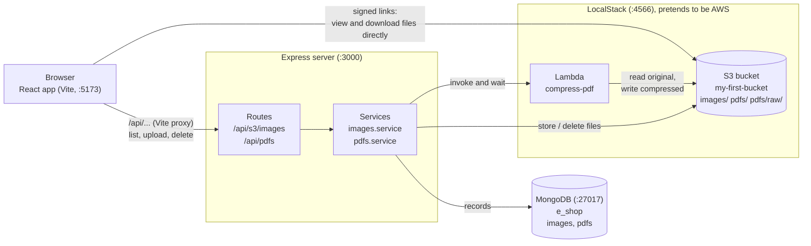
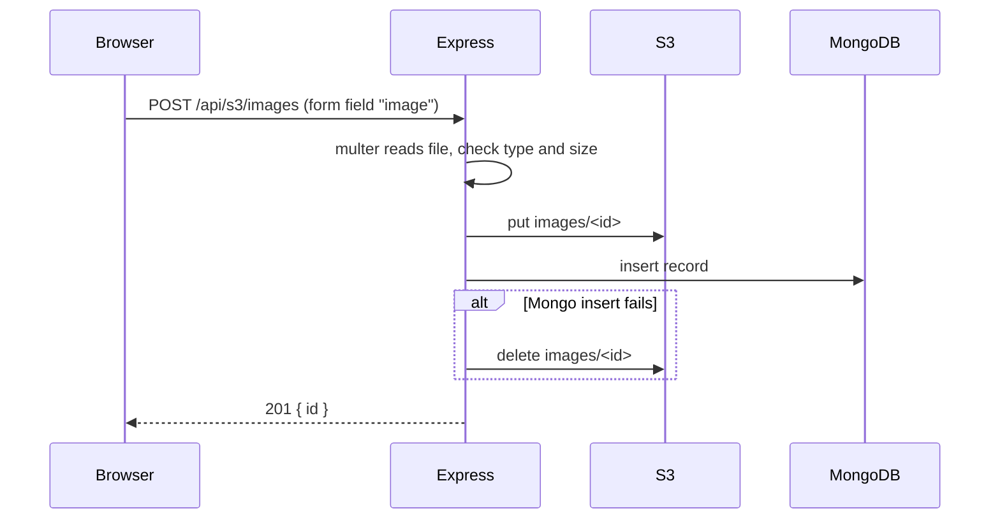
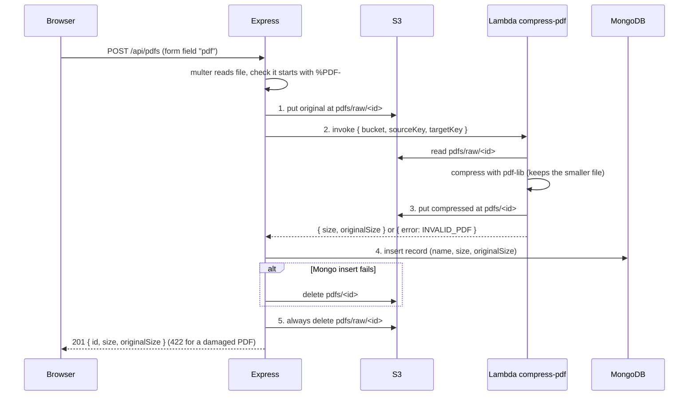
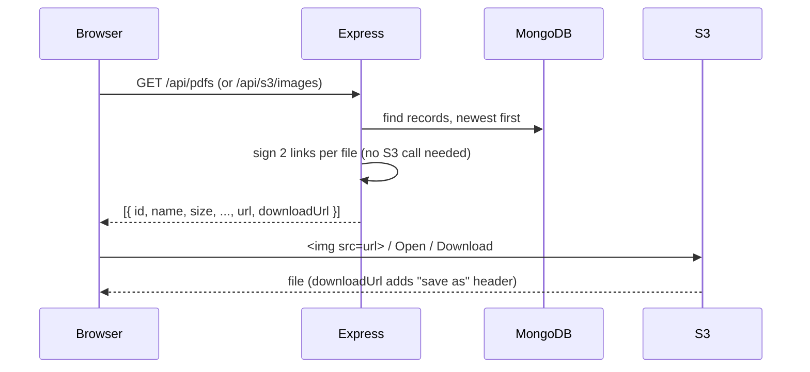

# Architecture

Diagrams use Mermaid. GitHub shows them as pictures; in VS Code install the "Markdown Preview Mermaid Support" extension.

## 1. The big picture



Rules the whole project follows:

- **Files live in S3, information about them lives in MongoDB.** The `_id` of a record is also the file name in S3.
- **Every file is written to S3 before its Mongo record**, and removed from S3 if the record can't be saved. So a record never points at a missing file.
- **File bytes never pass back through Express.** The list API returns signed S3 links, and the browser loads files straight from S3.

## 2. Image upload



## 3. PDF upload (with Lambda compression)



The Lambda receives S3 keys instead of the file, because a Lambda call can carry at most 6 MB.

## 4. Listing, viewing and downloading



- Links last 2 hours and stay identical for each clock hour, so the browser can cache files.
- The page reloads the lists every 30 minutes to get fresh links before they expire.

## 5. Deleting

`DELETE /api/pdfs/:id` or `/api/s3/images/:id`: find the record, delete the file from S3, then delete the record. Unknown id gives 404.

## 6. Folder structure

```
localstack/
├── client/                      React + Vite
│   └── src/
│       ├── api/                 fetch calls: images.ts, pdfs.ts, errorMessage.ts
│       ├── components/          UploadForm, ImageList, PdfUploadForm, PdfList
│       ├── App.tsx              loads lists, refreshes links every 30 min
│       └── formatSize.ts
├── server/                      Express + TypeScript (run directly by Node 24)
│   └── src/
│       ├── index.ts             connect Mongo, start server
│       ├── app.ts               mounts routers and error handler
│       ├── config/              aws.ts (shared AWS settings), db.ts (Mongo)
│       ├── middleware/          fileUpload.ts (multer), errorHandler.ts
│       └── modules/
│           ├── s3/              s3.client, s3.signer, images.* (routes → controller → service → repository)
│           ├── lambda/          lambda.client (invokeLambda)
│           └── pdfs/            pdfs.* (routes → controller → service → repository)
└── lambdas/
    └── compress-pdf/            index.mjs (the Lambda), deploy.sh
```

Each feature module has the same layers:

| Layer | Job |
|-------|-----|
| `*.routes.ts` | URL and HTTP method → controller |
| `*.controller.ts` | Read the request, validate it, send the response |
| `*.service.ts` | The steps: S3, Lambda, Mongo, and cleanup on failure |
| `*.repository.ts` | MongoDB queries only |
| `*.test.ts` | End-to-end tests against LocalStack and MongoDB |
