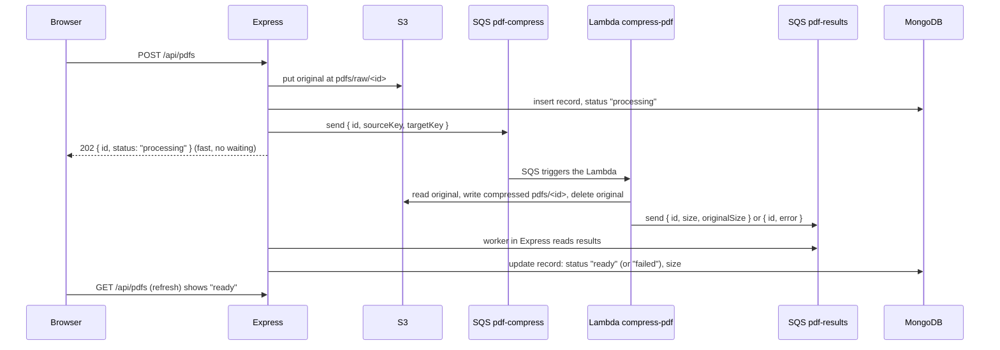

# Current design, and where SQS fits

> **Status: implemented (2026-11-09).** Sections 1–2 describe the design before SQS. `ARCHITECTURE.md` shows the design as it is now.

Full diagrams of the project as it is today are in `ARCHITECTURE.md`. This file covers the weak spot in the current design and how SQS (Simple Queue Service) fixes it.

## 1. Current design in one paragraph

The React app calls the Express API. Express stores files in S3 and their information in MongoDB. Images are stored as they are. PDFs go through a Lambda that compresses them. The browser views and downloads files straight from S3 through signed links. **Every step happens while the user waits**: an upload request only finishes after S3, the Lambda and MongoDB are all done.

## 2. The weak spot: PDF upload waits for the Lambda

Today's PDF upload:

```
Browser ──POST──> Express ──> S3 (original) ──> Lambda (compress, wait...) ──> MongoDB ──> reply
                  └──────────── the user waits for all of this ─────────────┘
```

Problems with this:

| Problem | What happens today |
|---------|--------------------|
| Slow for the user | Upload only finishes after compression. A big PDF can take many seconds, and the browser shows "Uploading…" the whole time. |
| No retry | If the Lambda fails or times out (cold start, AWS hiccup), the upload fails and the user must try again. |
| No protection from a rush | 100 uploads at once means 100 Lambdas at once, plus 100 Express requests held open. |
| Express is tied to the Lambda | If the Lambda is down or not deployed, PDF uploads stop working. |
| Lost work | If Express restarts during compression, the request is lost and the original stays in `pdfs/raw/`. |

## 3. Where to add SQS: between the upload and the Lambda



Two queues:

1. **`pdf-compress` (the job queue):** Express drops a message here and replies to the user straight away. SQS starts the Lambda for each message.
2. **`pdf-results` (the result queue):** the Lambda reports back here, and a small worker in Express saves the result in MongoDB.

**Why a result queue, instead of the Lambda writing to MongoDB itself?**
- It keeps the Lambda free of database passwords.
- MongoDB access stays in one place, Express's repository files.
- On LocalStack, a Lambda container can't easily reach the MongoDB on your machine.

On real AWS, letting the Lambda update MongoDB directly is also a fine, simpler choice.

## 4. Why SQS helps here

1. **Fast uploads.** Express replies as soon as the original is in S3, and compression runs in the background.
2. **Automatic retries.** If the Lambda fails, the message comes back to the queue and is tried again. You set how many times, for example 3.
3. **Failed jobs are kept, not lost.** After the last retry the message moves to a dead-letter queue (DLQ). You can look at it, fix the bug and run it again.
4. **Smooth under load.** 100 uploads become 100 messages. You can limit how many Lambdas run at once, and the rest wait safely in the queue.
5. **Loose coupling.** Express doesn't need the Lambda to be up. Messages wait in the queue until it is.
6. **Survives restarts.** Messages live in SQS, not in Express's memory.

## 5. What would change in the code

| Where | Change |
|-------|--------|
| `server/src/modules/sqs/sqs.client.ts` | New: SQS client and a `sendMessage()` helper, like `lambda.client.ts`. |
| `pdfs.repository.ts` | Record gets `status: 'processing' \| 'ready' \| 'failed'`. `size` is unknown until ready. Add `updatePdfRecord()`. |
| `pdfs.service.ts` | `savePdf` does S3 → Mongo (processing) → send message, no Lambda call. Add a function that handles a result message. |
| `server/src/modules/pdfs/pdfs.worker.ts` | New: polls `pdf-results` (long polling), updates MongoDB, deletes each message after it is handled. Started from `index.ts`. |
| `lambdas/compress-pdf/index.mjs` | Input becomes an SQS event (`event.Records[]`). It deletes the original itself, then sends the result to `pdf-results`. |
| `lambdas/compress-pdf/deploy.sh` | Also creates both queues, the DLQ, and the SQS → Lambda trigger (event source mapping). |
| `pdfs.controller.ts` | Reply `202 { id, status }` instead of `201` with sizes. |
| Client `PdfList` / `PdfUploadForm` | Show "Compressing…" for `processing` and "Failed" for `failed`. Hide Open/Download until ready, and refresh the list every few seconds while something is still processing. |
| `pdfs.test.ts` | Tests wait until the status becomes `ready` instead of checking the upload reply. |

## 6. Other places SQS could go later

- **Thumbnails (TODO step 8):** use the same pattern. Upload an image, put a job on a queue, and a Lambda makes the thumbnail.
- **Cleanup that failed:** if deleting a file from S3 fails, put a "delete this key" message on a queue and retry later instead of only logging it.
- **S3 events → SQS:** S3 itself can send a message when a file lands in `pdfs/raw/`, so Express doesn't even send the job. That's neater, but harder to follow while learning, so start with Express sending the message.

## 7. Where SQS is not worth it

- **Listing files, signing links and deleting records:** these are fast, and the user needs the answer right away, so queues would only add delay.
- **Image upload:** there's no slow processing step yet. Add a queue only when thumbnails arrive.

## 8. Trade-offs to know

- **The user doesn't get the compressed size immediately.** The UI must show a "processing" state.
- **A message can be delivered more than once.** The handler must be safe to run twice. Updating a record by `_id` to the same values already is.
- **More moving parts:** 2 queues, a DLQ, a worker, and status handling. Worth it once uploads are big or many. For a handful of small PDFs, today's design is simpler.
